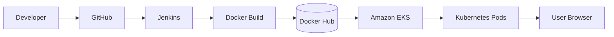
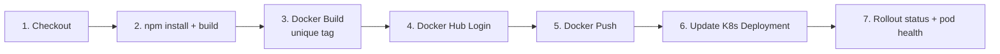
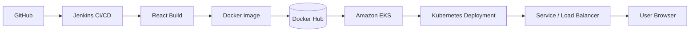

<h1 align="center">Booking App Frontend</h1>
<h3 align="center">End-to-End DevOps Deployment on Amazon EKS</h3>

<p align="center">
  
  
  
  
  
  
</p>

<p align="center">
  
</p>

<p align="center">
  <em>A responsive React + Vite booking frontend, containerized with Docker, built and shipped by Jenkins, stored in Docker Hub, and deployed on Amazon EKS.</em>
</p>

---

## At a Glance

| | |
| --- | --- |
| **Application** | Booking App frontend (SPA) |
| **Stack** | React.js, Vite, Bootstrap 5, Axios, React Router |
| **Container** | Multi-stage Docker build, served by Nginx on port 80 |
| **CI/CD** | GitHub, Jenkins, Docker Hub |
| **Platform** | Amazon EKS (`devops-eks`), Kubernetes Deployment + Service |
| **Region** | AWS Mumbai (`ap-south-1`) |
| **Release model** | Unique image tag per build, with Kubernetes rollout verification |

## Table of Contents

1. [Project Overview](#1-project-overview)
2. [Technologies Used](#2-technologies-used)
3. [Project Setup](#3-project-setup)
4. [Push Code to GitHub](#4-push-code-to-github)
5. [Create the Docker Image](#5-create-the-docker-image)
6. [Push the Image to Docker Hub](#6-push-the-image-to-docker-hub)
7. [Configure Jenkins CI/CD](#7-configure-jenkins-cicd)
8. [Connect to Amazon EKS](#8-connect-to-amazon-eks)
9. [Deploy the Frontend to Kubernetes](#9-deploy-the-frontend-to-kubernetes)
10. [Verify the Deployment](#10-verify-the-deployment)
11. [Troubleshooting](#11-troubleshooting)
12. [Security Best Practices](#12-security-best-practices)
13. [Final Deployment Workflow](#13-final-deployment-workflow)
14. [Project Outcome](#14-project-outcome)

---

## 1. Project Overview

This project demonstrates the end-to-end development and deployment of a frontend application using modern web technologies and DevOps tools.

**Deployment workflow**



---

## 2. Technologies Used

| Category | Tools |
| --- | --- |
| Frontend | React.js, Vite, JavaScript, HTML5, CSS3 |
| UI framework | Bootstrap 5 |
| API integration | Axios |
| Routing | React Router |
| Version control | Git, GitHub |
| Containerization | Docker |
| CI/CD | Jenkins |
| Container registry | Docker Hub |
| Orchestration | Kubernetes, Amazon EKS |
| Cloud provider | AWS |

---

## 3. Project Setup

### Prerequisites

Install Node.js, npm, Git, and Docker. For deployment, configure Jenkins, Docker Hub, AWS CLI, and kubectl.

Verify the tools:

```bash
node --version
npm --version
git --version
docker --version
```

### Clone the repository

```bash
git clone <YOUR_FRONTEND_GITHUB_URL>
cd <YOUR_FRONTEND_FOLDER>
```

### Install dependencies

```bash
npm install
```

### Run locally

```bash
npm run dev
```

Open the local URL displayed by Vite, usually `http://localhost:5173`.

### Create a production build

```bash
npm run build
```

Vite generates the production files in the `dist/` directory.

---

## 4. Push Code to GitHub

```bash
git add .
git commit -m "Update booking frontend"
git push origin main
```

> Use the correct branch name if your repository uses a different branch.

---

## 5. Create the Docker Image

Create a `Dockerfile` in the frontend project root. This example serves the app with Nginx on port 80.

```dockerfile
FROM node:22-alpine AS build

WORKDIR /app

COPY package*.json ./
RUN npm ci

COPY . .
RUN npm run build

FROM nginx:alpine

COPY --from=build /app/dist /usr/share/nginx/html

EXPOSE 80

CMD ["nginx", "-g", "daemon off;"]
```

Create a `.dockerignore` file:

```text
node_modules
dist
.git
.env
docs
```

Build the image:

```bash
docker build -t booking-frontend:1 .
```

Run the container locally:

```bash
docker run -d --name booking-frontend -p 8080:80 booking-frontend:1
```

Open `http://localhost:8080` to verify the application.

---

## 6. Push the Image to Docker Hub

Log in to Docker Hub:

```bash
docker login
```

Tag the image with your Docker Hub username:

```bash
docker tag booking-frontend:1 YOUR_DOCKERHUB_USERNAME/booking_frontend:1
```

Push the image:

```bash
docker push YOUR_DOCKERHUB_USERNAME/booking_frontend:1
```

Replace `YOUR_DOCKERHUB_USERNAME` with your actual Docker Hub username, then verify that the image appears in your Docker Hub repository.

---

## 7. Configure Jenkins CI/CD

Install or configure these tools on the Jenkins agent: Java, Jenkins, Docker, Git, AWS CLI, and kubectl.

Create a Jenkins Pipeline job and configure your frontend GitHub repository as the source. Store all credentials in **Jenkins Credentials**; never put passwords or access tokens in the Jenkinsfile.

**Pipeline stages**



| # | Stage | Purpose |
| --- | --- | --- |
| 1 | Checkout | Pull the frontend source from GitHub |
| 2 | Build | Install dependencies and build the React app |
| 3 | Docker Build | Build the image with a unique build tag |
| 4 | Docker Login | Authenticate to Docker Hub using Jenkins credentials |
| 5 | Docker Push | Push the image to Docker Hub |
| 6 | Deploy | Update the Kubernetes frontend Deployment |
| 7 | Verify | Wait for the rollout and confirm pod health |

Configure the pipeline with your actual repository URL, branch, Docker Hub credential ID, image name, and Kubernetes Deployment name.

---

## 8. Connect to Amazon EKS

Configure AWS credentials with the required EKS permissions on the machine running `kubectl`.

```bash
aws sts get-caller-identity

aws eks update-kubeconfig \
  --name devops-eks \
  --region ap-south-1

kubectl get nodes
```

Verify that the cluster is active and its worker nodes are `Ready`.

---

## 9. Deploy the Frontend to Kubernetes

Create or update a frontend Deployment manifest that references your pushed Docker Hub image.

Example container configuration:

```yaml
containers:
  - name: frontend
    image: YOUR_DOCKERHUB_USERNAME/booking_frontend:1
    ports:
      - containerPort: 80
```

Include this inside a complete Kubernetes Deployment manifest, and create a Service to expose the frontend.

Apply the manifests:

```bash
kubectl apply -f k8s/
```

Check the resources:

```bash
kubectl get deployments
kubectl get pods
kubectl get services
```

Verify the rollout (use your actual Deployment name):

```bash
kubectl rollout status deployment/<FRONTEND_DEPLOYMENT_NAME>
```

For public access, configure a LoadBalancer Service or an Ingress with the AWS Load Balancer Controller and the required AWS networking permissions.

---

## 10. Verify the Deployment

Check pod status:

```bash
kubectl get pods -o wide
```

Inspect logs if the application fails:

```bash
kubectl logs deployment/<FRONTEND_DEPLOYMENT_NAME>
```

Check the Service and its external address, if configured:

```bash
kubectl get services
kubectl get ingress
```

Open the configured public endpoint and confirm the frontend loads.

---

## 11. Troubleshooting

| Problem | Action |
| --- | --- |
| `npm` build fails | Check dependencies and build logs |
| Docker build fails | Verify the Dockerfile and package configuration |
| Docker push denied | Check Docker Hub login and repository permissions |
| `ImagePullBackOff` | Verify image name, tag, and registry access |
| `CrashLoopBackOff` | Inspect pod logs and events |
| Jenkins waits for executor | Check agent status, labels, and available executors |
| EKS access denied | Verify AWS identity and EKS permissions |
| Frontend cannot call backend | Check API URL, CORS, and backend Service connectivity |

---

## 12. Security Best Practices

- Never commit secrets, passwords, or private keys to GitHub.
- Use Jenkins Credentials for registry authentication.
- Use unique image tags instead of relying on `latest`.
- Expose only the required application endpoints.
- Keep the database private and allow access only from the backend.
- Use least-privilege IAM permissions.

---

## 13. Final Deployment Workflow



---

## 14. Project Outcome

This project demonstrates frontend development, source-code management, Docker containerization, automated CI/CD, container registry management, and Kubernetes deployment on AWS.

| | |
| --- | --- |
| **Author** | Ajay Dhadi |
| **Cloud region** | AWS Mumbai (`ap-south-1`) |
| **Project type** | End-to-end frontend DevOps deployment |

---

<p align="center">
  <sub>Built by <strong>Ajay Dhadi</strong> | AWS · DevOps · Infrastructure as Code</sub>
</p>
